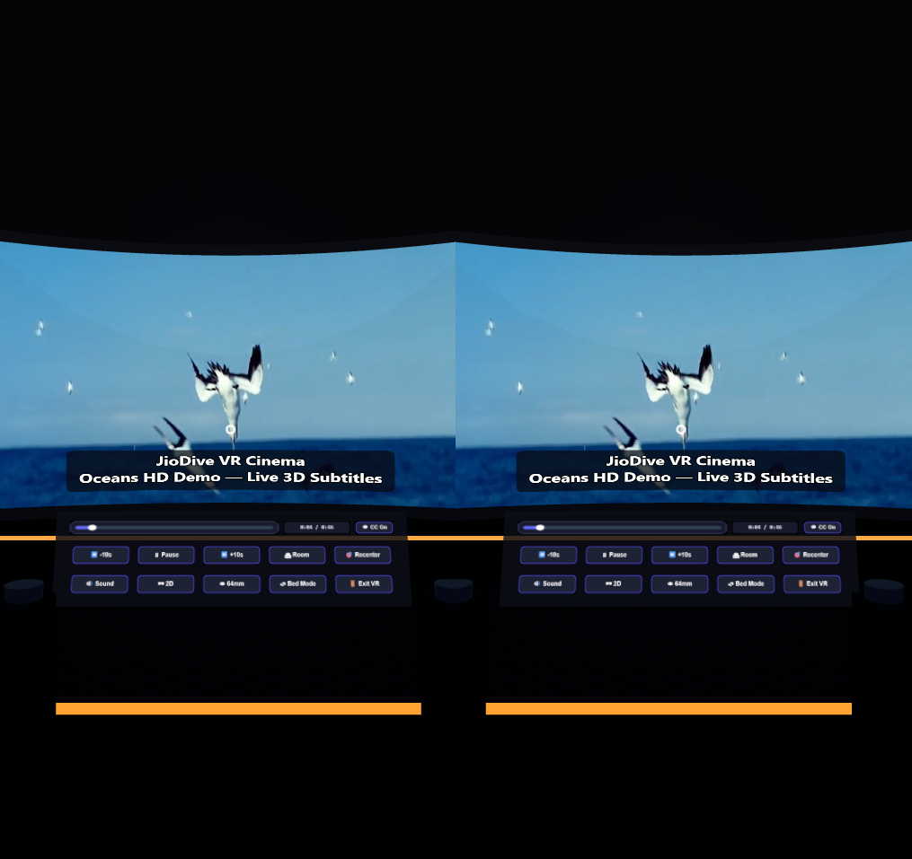

# 🥽 JioDive VR Cinema

[](LICENSE)

A static, browser-based Virtual Reality Theater player built with Three.js and Vite for the **JioDive VR Headset** and mobile browsers (Android Chrome, Brave, Samsung Internet, and iOS Safari).

> **Hosted Demo (HTTPS):** [`https://0xarunabha.github.io/jiodive-cinema/`](https://0xarunabha.github.io/jiodive-cinema/)  
> *(Serves the static `dist/` build via [GitHub Pages workflow](.github/workflows/deploy.yml) — enable **Settings ➔ Pages ➔ GitHub Actions** once on the repository so gyroscope, wake lock, and fullscreen run over trusted HTTPS without local Vite setup or self-signed SSL warnings.)*



---

## ✨ Features

- **Stereoscopic Dual-Eye Rendering:** Software side-by-side stereoscopic rendering with customizable Interpupillary Distance (IPD: 58mm, 64mm, 68mm, 72mm) and Field of View (FOV: 70°–85°), adjustable both in the launcher and live inside VR. *(No per-device optical barrel distortion shader is applied.)*
- **Dynamic Reticle Depth Matching:** The gaze reticle dynamically projects to the exact 3D distance of whatever you're looking at (floating buttons at ~4.5m or movie screen at ~6.5m) with proportional scaling, avoiding stereo diplopia (double vision).
- **Physical Click Trigger Integration:** Uses JioDive's capacitive button:
  - Single click on a button to activate.
  - Single click in empty space to toggle menu visibility.
  - Fast double click (< 350ms) to recenter yaw drift without triggering single-click actions.
- **Multiple Virtual Environments:**
  - 🏛 **Grand Cinema Hall:** Multi-tier theater with curved screen, amber aisle runner LED strips, stage clearance, and real-time screen light bounce.
  - 🌌 **Void Mode (OLED):** Pure pitch black space with floating screen (skips environment lighting updates and minimizes pixel draw for mobile battery life).
  - 🛏 **Bed Mode:** Screen and control menu reorient upward together onto the ceiling so you can watch lying flat.
- **Comprehensive 3D Format Support:**
  - Standard 2D movies (shared single `VideoTexture` for minimal GPU upload overhead).
  - 3D Half Side-by-Side (Half-SBS) with 2:1 anamorphic aspect correction.
  - 3D Full Side-by-Side (Full-SBS).
  - 3D Half Over-Under (Half-OU) with 2:1 anamorphic aspect correction.
  - 3D Full Over-Under (Full-OU).
- **Interactive Timeline & Scrubbing:** Floating gaze seek bar with hover time preview (`➔ MM:SS`) and current/total duration readout directly inside VR, plus `⏪ -10s` / `⏩ +10s` quick skips.
- **VR Subtitles (`.srt` / `.vtt`):** Load local `.srt` or `.vtt` subtitle files in the launcher to render stereo-converged captions on a curved layer just in front of the cinema screen (works in 2D, 3D SBS/OU, and Bed Mode, with live `💬 CC On/Off` toggling in VR).
- **Local Files & Online URL Streaming:**
  - Load local video files (MP4 H.264/AAC, WebM) directly from device storage.
  - Stream CORS-enabled online video URLs (`https://...`).
  - Built-in Oceans HD sample stream with automatic MP4/WebM codec selection.
- **Clean In-VR Navigation & Saved Fit:** Switch rooms, toggle formats, cycle IPD (automatically saved across sessions), or click `🚪 Exit VR` anytime to return to the launcher without reloading.
- **Screen Wake-Lock & Non-Blocking Entry:** Keeps the display awake while watching, re-acquires wake lock on `visibilitychange`, and enters VR immediately without stalling on WebView fullscreen/wake-lock promises.
- **Mobile-Optimized Performance:** Lambert shading with baked sconce glow textures, no redundant per-frame `VideoTexture` uploads, paused 3D render loop behind the 2D launcher.

---

## 🌐 Hosting / Static Deployment (Recommended)

Gyroscope (`DeviceOrientationEvent`), Screen Wake Lock, and Fullscreen APIs require a **trusted HTTPS origin** on phones. Because this app is 100% static after `npm run build`, deploying `dist/` to any static HTTPS host removes the need for local dev servers or bypassing self-signed certificates:

- **GitHub Pages (included):** Enable **Settings ➔ Pages ➔ Source: GitHub Actions**; [`.github/workflows/deploy.yml`](.github/workflows/deploy.yml) automatically builds and publishes `dist/` on every push to `main`.
- **Cloudflare Pages / Netlify / Vercel:** Connect the repository with build command `npm run build` and publish directory `dist` (`vite.config.js` configures `base: './'` so assets resolve from any subpath or domain).

---

## 📱 Mobile Setup & Platform Notes

### Android (Chrome / Brave / Samsung Internet)
1. Open the hosted HTTPS URL (or local dev HTTPS URL).
2. Allow motion/orientation sensor access if prompted.
3. Tap **"Enter VR & Insert into JioDive"** — the app requests fullscreen and landscape orientation lock.

### iOS Safari (iPhone)
iOS Safari does not support the HTML5 Fullscreen API for regular web tabs. To watch edge-to-edge without Safari browser toolbars:
1. Open the hosted HTTPS URL in Safari.
2. Tap **Share** ➔ **"Add to Home Screen"** ➔ **Add**.
3. Open **JioDive VR** from your Home Screen (`display: standalone` via PWA manifest).
4. Allow **Motion & Orientation Access** when prompted (or under *iOS Settings > Safari*).

---

## 🚀 Local Development

Requires **Node.js 18+** (uses Vite `>= 6.1.0` with `--configLoader native`):

```bash
npm install
npm run dev
```

Vite serves the app over local HTTPS using `@vitejs/plugin-basic-ssl`:
```
  ➜  Local:   https://localhost:5173/
  ➜  Network: https://192.168.1.x:5173/
```

Open the Network URL on your phone over the same Wi-Fi network *(accept the local self-signed dev certificate if prompted)*.

---

## 🎮 JioDive Controls Guide

| Action | Control |
| :--- | :--- |
| **Select Button / Action** | Aim the center reticle at any floating button and **click the JioDive physical button**. |
| **Toggle Menu (Hide/Show)** | **Click the physical button** while aiming at empty space / movie screen. |
| **Recenter Screen (Fix Drift)** | **Double-click** the physical button quickly (< 350ms). |
| **Seek Timeline** | Aim anywhere along the top progress bar (displays `➔ MM:SS` preview) and **click** to jump directly to that timestamp. |
| **Toggle Subtitles** | Click **💬 CC** in the top bar (`On` / `Off`) after loading an `.srt` or `.vtt` file in the launcher. |
| **Cycle IPD** | Click **👁 IPD** in the VR menu (58mm ➔ 64mm ➔ 68mm ➔ 72mm). |
| **Cycle Format** | Click **🕶 Format** in the VR menu (2D ➔ Half-SBS ➔ Full-SBS ➔ Half-OU ➔ Full-OU). |
| **Bed / Lay-Down Mode** | Click **🛏 Bed Mode** to tilt both screen and menu upward together. |
| **Exit VR** | Click **🚪 Exit VR** or exit fullscreen to return to the movie selection launcher. |

---

## 📄 License

This project is licensed under the MIT License — see the [LICENSE](LICENSE) file for details.

